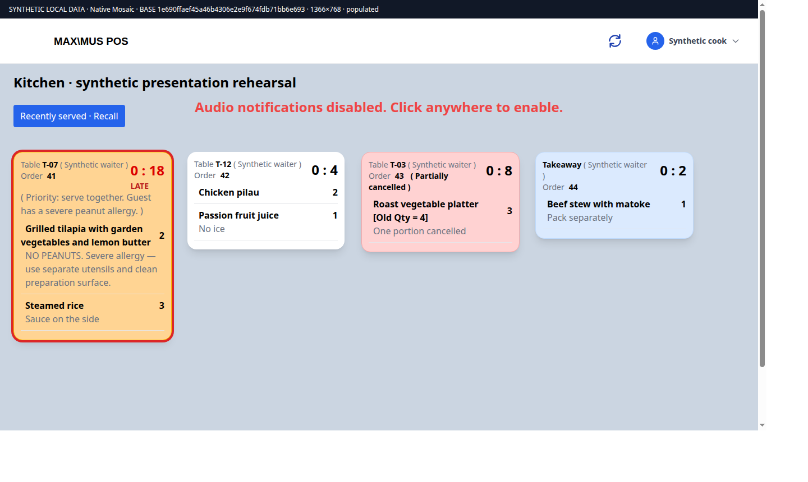
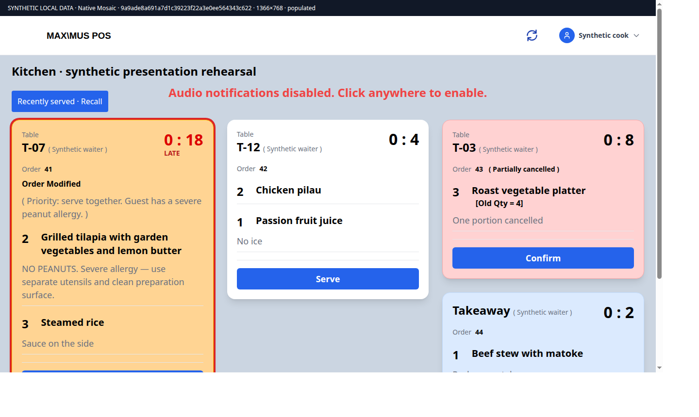
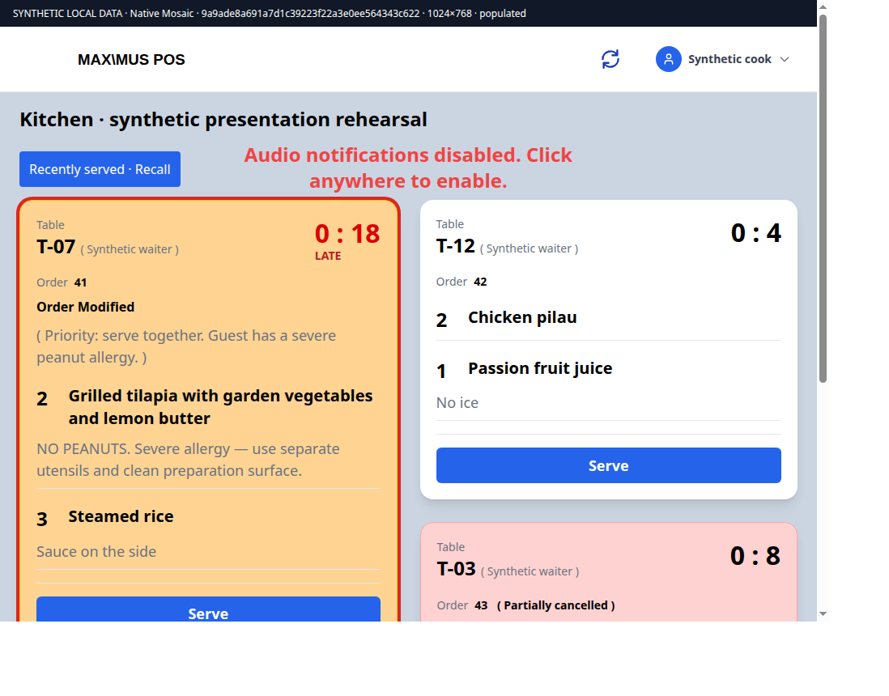
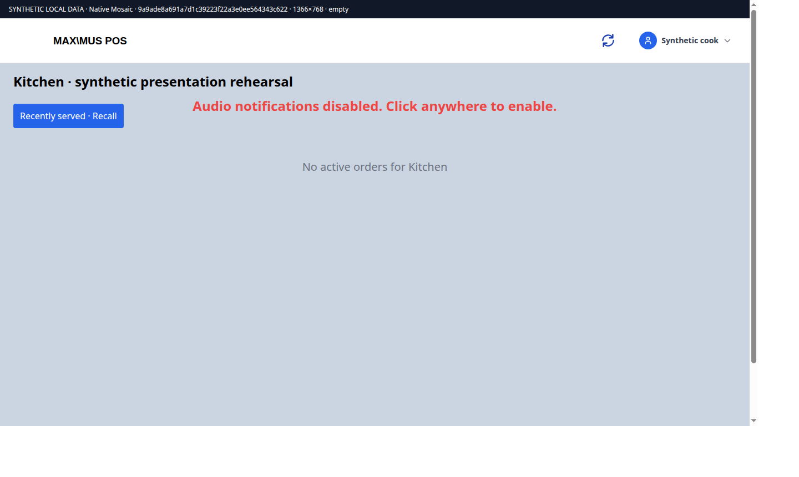
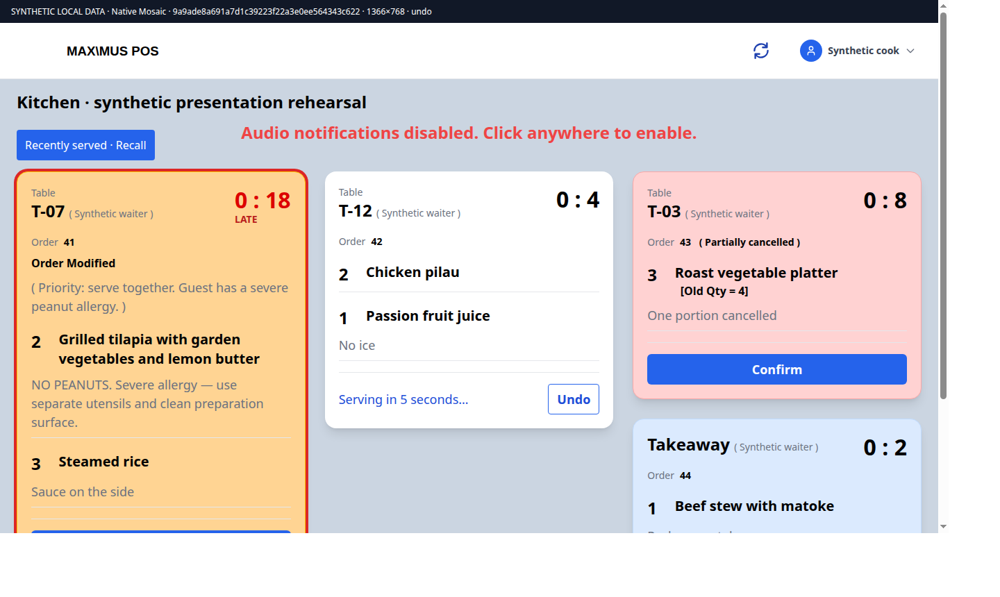
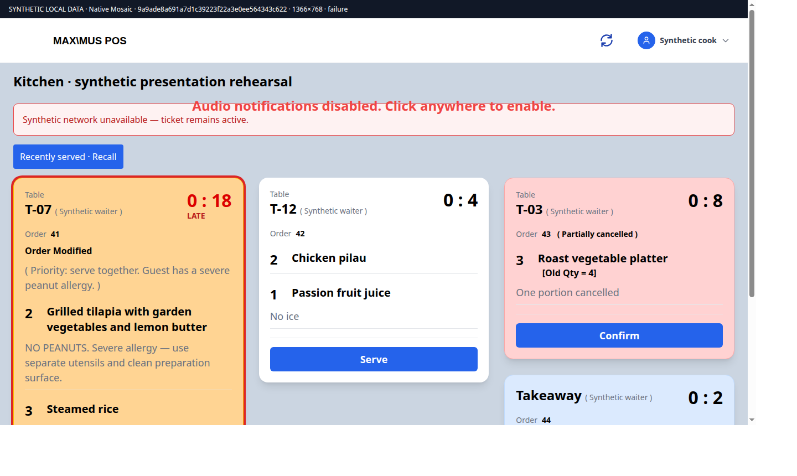

# Salama Mosaic readability: actual implementation screenshots

These unedited PNGs render the native `mosaic/src/components/kot.vue`, native Header/CSS and existing Masonry library in an isolated local Chrome profile. Actual source revision: `9a9ade8a691a7d1c39223f22a3e0ee564343c622`; immutable comparison base: `1e690ffaef45a46b4306e2e9f674fdb71bb6e693`. This evidence-only commit does not change production source.

Fixtures replace API/socket boundaries and use synthetic records; no live ERP credentials, writes or restaurant records. Native inner viewport is 1366×768 or 1024×768; the outer capture includes a source/data banner and may have different raster dimensions. Images are not scaled mockups. Chrome 154 headless capture used a fresh temporary profile with standard sandbox enabled. Manifest records capture time, source, viewport, dimensions and SHA-256.

The baseline and changed source use the same populated dataset. Long-note tickets scroll below the viewport; actions remain after their content. Undo and failure screenshots seed native pending/error presentation state for deterministic capture; they do not prove actual five-second timing or a real failed request. Targeted tests separately exercise those handlers. The header highlights the native footer instead of covering dishes/notes with the previous overlay; header and footer-background dismissal call the unchanged native rotate handler. Serve/Confirm/Undo guards remain native. The script block is byte-identical to the comparison base.

Parent visually inspected desktop, tablet, Undo and failure screenshots. Ordinary-role login, painted keyboard focus/contrast, physical display, audio, Recall interaction and end-to-end waiter/kitchen/cashier acceptance remain pending. No deployment, merged integration, CI success or ready-for-review claim.

## kitchen-before-1366

## kitchen-after-1366

## kitchen-after-1024

## kitchen-empty-1366

## kitchen-undo-1366

## kitchen-highlighted-1366

## kitchen-failure-1366

