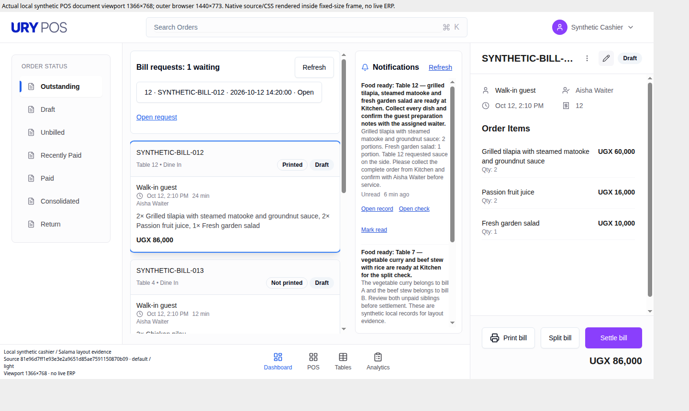
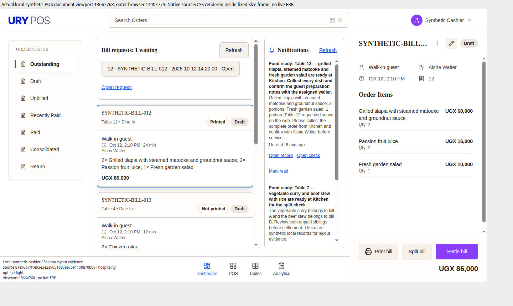

# Hospitality theme — local rendered evidence

Captured source: `81e96d7ff1e93e3e2a9651d85ae7591150870b09`.
The evidence commit adds these images and captions only; application source remains
at the captured revision. This comparison uses the same candidate with the fixed
hospitality opt-in off and on, rather than comparing different layout branches.

All three captures render actual native POS AppLayout, Orders, Notifications,
Header/Footer, stores and CSS. The scratch harness mocks external Frappe, printing
and realtime boundaries and blocks business writes. The operator, bills, items,
bill request and alerts are synthetic local records. No live ERP session or
business transaction is represented. The unchanged native URY fallback logo is
served; the live site's MAX\\MUS branding selection is not exercised here.

The native POS document is **1366 × 768**, rendered inside a fixed-size iframe.
The captured PNG is **1440 × 860**, including the viewport wrapper and margins.
Each capture includes source and dataset labels. Dates, URLs, byte counts and
verified SHA-256 hashes are recorded in [capture-manifest.json](capture-manifest.json).
Browser zoom was not independently attested.

## Default / opt-in off

Same candidate, no hospitality selection. This is the visual comparison control.

## Hospitality opt-in

Same candidate and dataset, `theme=hospitality` in the scratch harness. Warm
neutral surfaces and system-serif headings appear; existing order states, bill
controls, notification links and brand action colors remain native.

## Requested dark-class control

Capture requested `theme=hospitality&dark` in the scratch harness. Hospitality's
warm/serif appearance is excluded and the shell looks like the default capture.
This control is **not full dark-mode visual acceptance**; the image alone does
not establish complete dark-palette rendering or device-mode activation.
Existing source-token and native selected-state dark controls remain covered by
the focused tests.

## Remaining acceptance

These images establish local rendered comparison evidence. They do not establish
ordinary-role permissions, live MAX\\MUS branding, waiter/kitchen device appearance,
actual kitchen viewing distance, enlarged text, keyboard/hover interactions,
reduced motion, CSP/bench serving, or a deployed/served revision. The native modal
backdrop and selected-room regressions are covered by committed RED/GREEN tests,
not demonstrated by these Orders-page captures. No tenant activation, deployment,
merge or ready-for-review transition is included.
